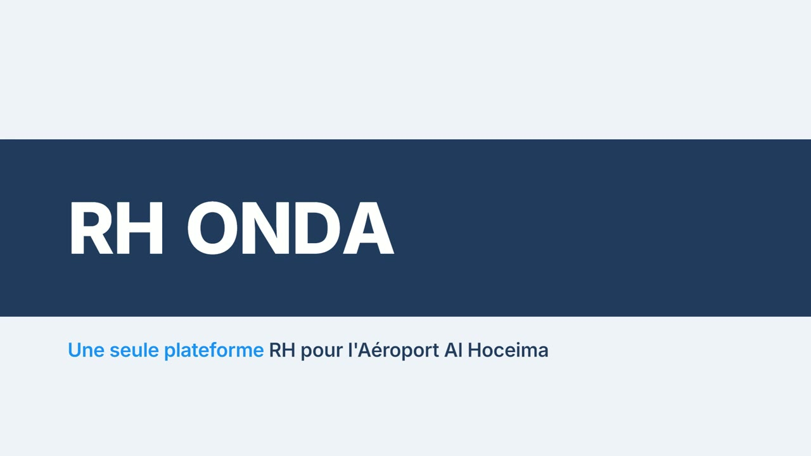

# RH ONDA — Gestion RH Aéroport Al Hoceima

Application web de gestion RH (personnel, congés, formations) avec tableau de bord analytique, développée pour l'aéroport Al Hoceima (PFE).

## Stack

- **Frontend** : React 19, Vite, Recharts
- **Backend** : Laravel 13 (PHP 8.3), Sanctum
- **BDD** : MySQL (prod) / SQLite (dev)
- **Infra** : Docker Compose, Nginx
- **Sync** : macros VBA Excel → MySQL

## Lancer le projet

**Avec Docker :**
```bash
docker compose up --build
```
→ http://localhost

**En local :**
```bash
# Backend
cd backend && composer install && cp .env.example .env
php artisan key:generate && php artisan migrate && php artisan serve

# Frontend
cd frontend && npm install && npm run dev
```

## Vidéo de présentation

[](docs/rh-onda-presentation.mp4)

Présentation de la plateforme pour la direction (1 min 28 s, 1920×1080, réalisée avec [HyperFrames](https://hyperframes.heygen.com)) : de la ressaisie dans trois classeurs Excel jusqu'au rapport PS09 rempli à partir des données. Captures réelles de la plateforme sur la base de démonstration (données fictives).

[▶ Regarder la vidéo (MP4, 18,5 Mo)](docs/rh-onda-presentation.mp4)

## Fonctionnalités

- Authentification (rôle unique : RH)
- Dashboard KPI (effectif, H/F, âges, ancienneté)
- Gestion du personnel (CRUD, import Excel)
- Fiche employé (profil, congés, formations, documents)
- Suivi des congés (HRAccess, ONDA)
- Gestion des formations
- Synchronisation Excel ↔ plateforme

## Auteur

Anass El Ghalbzouri — PFE, Aéroport Al Hoceima · Airports of Morocco · 2026
